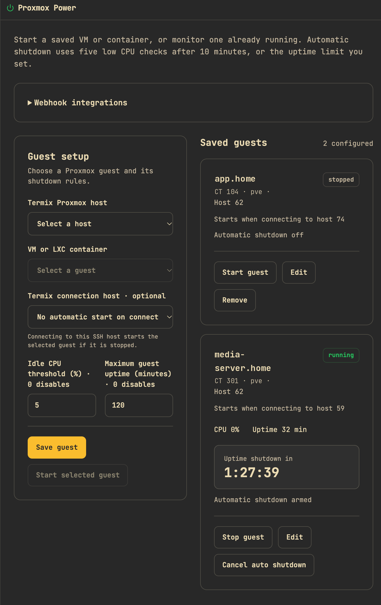
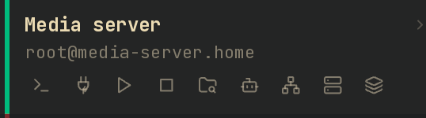

# Proxmox Power

Start Proxmox VMs and LXC containers from Termix, and shut them down gracefully when they sit idle or reach an uptime limit.

## Turn it on

1. Add the Proxmox node as a normal SSH host in Termix. Its SSH account must be allowed to run `pvesh`.
2. In that host's editor, enable **Proxmox Power**.

## Save a guest

1. Open the **Proxmox Power** tab.
2. Pick the **Termix Proxmox host**, then the **VM or LXC container**.
3. Optionally pick a **Termix connection host**: the SSH host you use to log in to that guest.
4. Set the **Idle CPU threshold** and **Maximum guest uptime**. `0` turns a rule off.
5. Press **Save guest**, or **Start selected guest** to save and start it.

## Start and stop guests

- **Start guest** starts a saved guest and arms automatic shutdown.
- **Monitor guest** arms automatic shutdown for a guest that is already running.
- **Stop guest** asks Proxmox for a graceful shutdown now.
- **Cancel auto shutdown** leaves the guest running.

A linked connection host gets three actions in the host list: **Start Proxmox guest and connect**, **Start Proxmox guest** and **Shut down Proxmox guest**. Clicking the host itself still opens a normal SSH terminal.

## Automatic shutdown

Monitored guests are checked once a minute. After a ten-minute boot grace period, five checks in a row below the CPU threshold request a graceful shutdown. The uptime limit counts the guest's total uptime from Proxmox, and the tab shows a countdown to it. A shutdown is never forced: if the guest ignores it, the tab shows an error after five minutes.

Low CPU alone doesn't prove a guest is safe to stop. Pick rules that suit the workload, and enable the QEMU guest agent on VMs so they shut down reliably.

## Automation

Scripts can start and stop saved guests through the authenticated Termix API with an API key for a user who has the **Control guests** permission. See the API reference for the routes.
